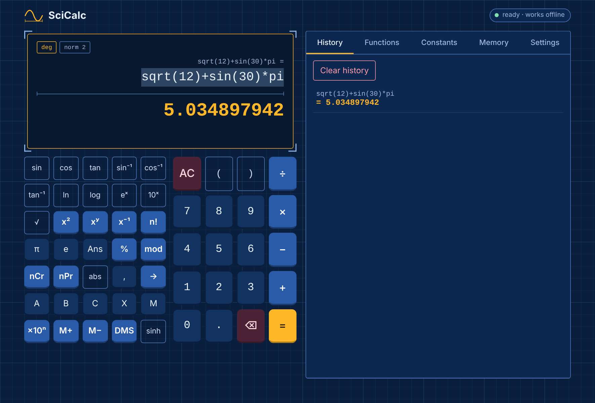
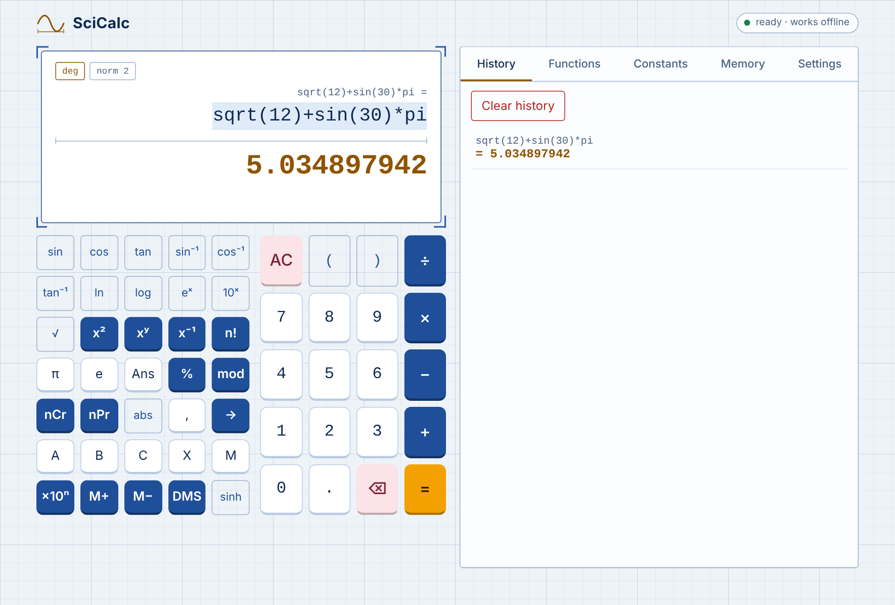
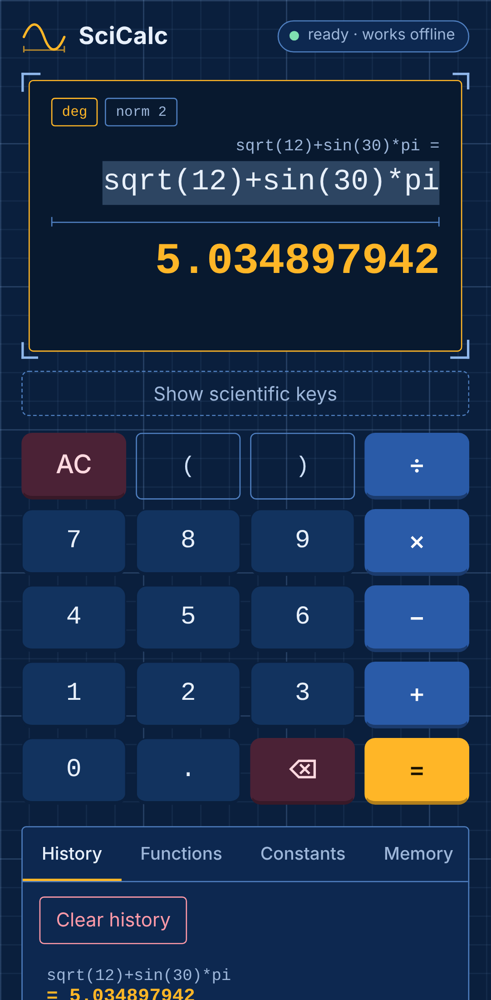
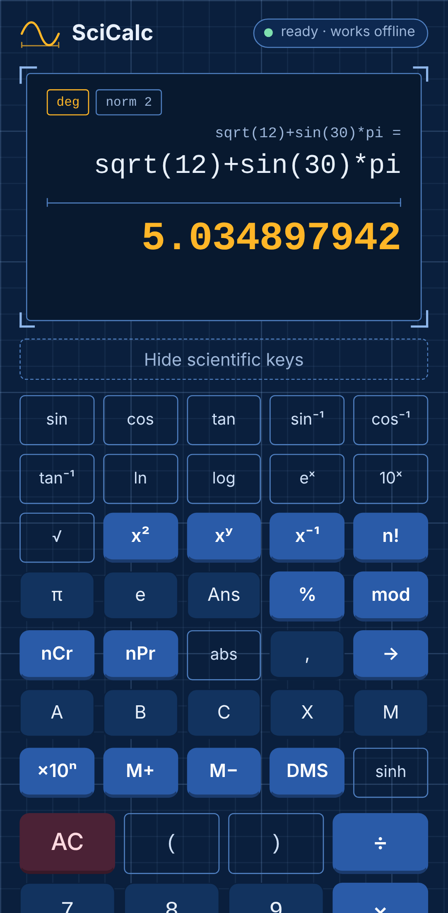
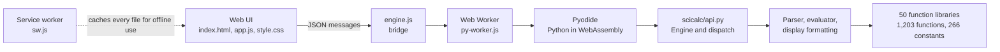

<div align="center">

# SciCalc

**A scientific calculator with 1,200+ functions and 260+ constants, written in Python, that runs in any browser and works fully offline.**

[](https://scicalc-scientific-calculator.netlify.app/)




</div>

---

## Contents

- [What is SciCalc?](#what-is-scicalc)
- [Try it](#try-it)
- [Features](#features)
- [Examples](#examples)
- [Screenshots](#screenshots)
- [How it works](#how-it-works)
- [Run it yourself](#run-it-yourself)
- [Deploy your own copy](#deploy-your-own-copy)
- [Testing](#testing)
- [Project structure](#project-structure)
- [Roadmap](#roadmap)
- [License and credit](#license-and-credit)

---

## What is SciCalc?

SciCalc is a Casio-style scientific calculator with a much larger function library than a handheld one: **1,203 functions in 50 categories and 266 constants**, from trigonometry and matrices to chemistry, finance and unit conversion.

You type an expression such as `sqrt(12)+sin(30)*pi` and get the answer, with the display modes you would expect from a scientific calculator (Norm, Fix, Sci, Eng, fractions, degrees/radians/grads, hex/bin/oct, DMS).

The calculator engine is **plain Python**. The same code powers three things:

| Where | How |
|---|---|
| **Browser / phone app** | Python runs inside the page through Pyodide (WebAssembly). After the first load there is no server and no internet needed. |
| **Command line** | `python calculator.py` |
| **Other programs** | A small JSON-friendly API (`scicalc/api.py`) any app can call. |

## Try it

**Open the app: https://scicalc-scientific-calculator.netlify.app/**

It works on Windows, macOS, Linux, Android, iPhone/iPad and Chromebook, in current Chrome, Edge, Firefox and Safari. Nothing to download or sign up for.

**Install it like a normal app** (optional, and it then works with Wi-Fi switched off):

| Device | How |
|---|---|
| Android (Chrome) | Menu (⋮) → **Install app** or **Add to Home screen** |
| iPhone / iPad (Safari) | **Share** → **Add to Home Screen** |
| Windows / macOS / Linux (Chrome or Edge) | Click the install icon in the address bar, or the **Install app** button in SciCalc |

The first start takes a few seconds while the Python engine loads (about 14 MB is saved on your device). After that, it opens instantly and needs no internet.

## Features

**Calculating**
- Full expression parser: brackets, operator precedence, implicit multiplication, `Ans`, variables and memory (`M+`, `M−`, `A`–`X`).
- **Display modes:** Norm, Fix, Sci, Eng, fractions (improper or mixed), symbolic-looking output (π, √), DMS, and hex/bin/oct.
- **Angle modes:** degrees, radians, grads.
- **Complex numbers**, lists and matrices as first-class values.
- Your own **user-defined functions**, and error messages that say what went wrong and where (`Syntax ERROR`, `Math ERROR`, `Argument ERROR`).
- Tables of values for any function with `table1` and `table2`.

**Library, 1,203 functions in 50 categories, for example:**

| Area | Includes |
|---|---|
| Mathematics | Trigonometry, hyperbolic, exponentials and logs, powers and roots, calculus, algebra and sequences, special functions |
| Number theory and discrete | Combinatorics, primes, gcd/lcm, base-N and logic |
| Linear algebra | Matrices, vectors, advanced linear algebra, 3D geometry |
| Statistics and data | Descriptive statistics, regression, probability distributions, inference tests, non-parametric tests and ANOVA, machine-learning helpers |
| Science and engineering | Physics, chemistry, electronics and signals, thermodynamics and fluids, engineering and materials, astronomy and orbital mechanics, acoustics and optics |
| Everyday | Finance, unit conversions (83 functions), health and fitness, cooking and home, calendar and dates |

**The app**
- **Searchable Functions and Constants browser**: find any of the 1,203 functions by name or category, read what it does, and run its built-in example with one tap.
- **History** (tap an entry to reuse it), **Memory** and **Settings** tabs.
- Tap the result to copy it.
- Blueprint-style interface with automatic **dark and light themes**, press animations on every control, and a responsive layout that adapts from phone to desktop.
- Remembers your settings and session between visits.

## Examples

Type these into the calculator:

| Expression | Result |
|---|---|
| `sqrt(12)` | `3.464101615` |
| `sin(30)` (in degree mode) | `0.5` |
| `2^10` | `1024` |
| `(2+3i)*(1-i)` | `5+i` |
| `nCr(10,3)` | `120` |
| `factorial(10)` | `3628800` |
| `gcd(48,18)` | `6` |
| `7*list_seq(5)` | `{7, 14, 21, 28, 35}` |
| `table1('x^2+1', 0, 3, 1)` | `{{0, 1}, {1, 2}, {2, 5}, {3, 10}}` |

> **Making a multiplication table:** `7*list_seq(10)` gives the first ten multiples of 7. Replace `7` with any number.

## Screenshots

<table>
  <tr>
    <td align="center"><b>Dark theme</b></td>
    <td align="center"><b>Light theme</b></td>
  </tr>
  <tr>
    <td></td>
    <td></td>
  </tr>
</table>

<table>
  <tr>
    <td align="center"><b>Phone</b></td>
    <td align="center"><b>Phone, scientific keys</b></td>
  </tr>
  <tr>
    <td></td>
    <td></td>
  </tr>
</table>

## How it works



- **Parser and engine** (`parser.py`, `engine.py`): turn text into a result, with precision-aware formatting in `display.py`.
- **Registry** (`registry.py`): every function and constant registers itself with a decorator, such as `@register("nCr", ...)`. The Functions tab, the help text and the self-test are all generated from the same registry, so they cannot drift apart.
- **API** (`api.py`): the only door apps use. Every answer is plain data (dict, list, string, number) and no Python exception ever escapes.
- **Web Worker**: Python runs off the main thread, so the screen never freezes. If a calculation takes longer than 20 seconds, the worker is restarted and your session is restored.
- **Service worker**: precaches the 18 app files, so once loaded the app works with no network.
- **Nothing leaves your device.** There is no backend, no tracking and no account.

## Run it yourself

You only need **Python 3** installed.

```bash
git clone https://github.com/username/repository.git
cd repository
```

**Web app on your computer**

```bash
python serve.py
```

Then open <http://localhost:8000>. (Opening `index.html` by double-clicking does not work, because browsers block WebAssembly for files opened from disk.)

**Command-line calculator**

```bash
python calculator.py
```

**List every registered function**

```bash
python calculator.py --selftest
```

## Deploy your own copy

SciCalc is a static site, so any static host works. The app lives in the `webapp/` folder.

**Netlify:** import this repo and leave the build command empty. The included `netlify.toml` already sets the publish directory to `webapp`.

**GitHub Pages, Cloudflare Pages or any other host:** publish the `webapp/` folder.

Remember: install and offline mode need an **https** address (or `localhost`).

**After changing the engine**, rebuild the browser bundle:

```bash
python build_app.py
```

This regenerates `webapp/scicalc.zip` and `webapp/assets.js` (the file list and version the service worker uses).

## Testing

```bash
python calculator.py --selftest     # all 25,754 checks
python run_tests.py --all           # every module, one section each
python run_tests.py lib_trig        # just one module
python run_tests.py --topics        # list the test topics
python scicalc/lib_trig.py          # running a module file directly tests that module
```

The suite has **25,754 checks** with **0 problems**, covering every function, the parser's error handling, display modes, saving and loading sessions, and the app API. The code is also clean under Pyright (Python 3.12, basic mode), configured in `pyrightconfig.json`.

## Project structure

```text
.
├── calculator.py          command-line entry point
├── run_tests.py           per-module and full test runner
├── build_app.py           builds the browser bundle (scicalc.zip, assets.js)
├── serve.py               tiny local web server
├── get_pyodide.py         downloads Pyodide into webapp/pyodide
├── netlify.toml           Netlify settings
├── scicalc/               the calculator engine (47 modules)
│   ├── errors.py, registry.py, arithmetic.py, display.py
│   ├── parser.py, engine.py
│   ├── lib_*.py           function libraries (trig, physics, finance, ...)
│   ├── constants_expansion.py
│   ├── api.py             the plain-data interface used by apps
│   └── tests/             36 test files
├── webapp/                the offline web app (PWA)
│   ├── index.html, style.css, app.js
│   ├── engine.js, py-worker.js, sw.js
│   ├── manifest.webmanifest, icons/
│   ├── pyodide/           Python for the browser
│   └── scicalc.zip        the engine, packaged for the browser
└── docs/screenshots/
```

Each module can be tested on its own, and `scicalc/MODULES.md` describes what every module does.

## Roadmap

- Higher-precision mode (`Decimal`-based arithmetic)
- Edit and recall entries in the history
- Graph plotting in the app
- Packaged desktop and phone installers

## License and credit

Released under the **SciCalc License**. See [`LICENSE`](LICENSE) and [`COPYRIGHT.txt`](COPYRIGHT.txt) for what you may and may not do with the code.

Created and maintained by **[biman-cybersec](https://github.com/biman-cybersec)**.

If you find a bug or have an idea, please [open an issue](https://github.com/biman-cybersec/SciCalc---Scientific-Calculator/issues).
